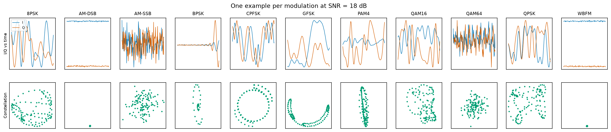
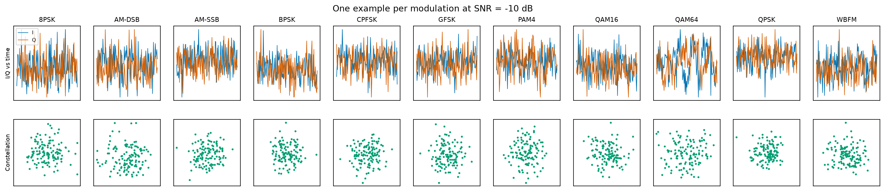
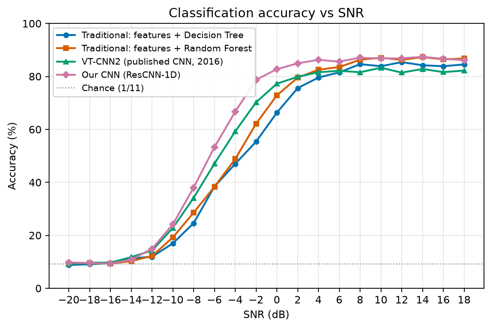
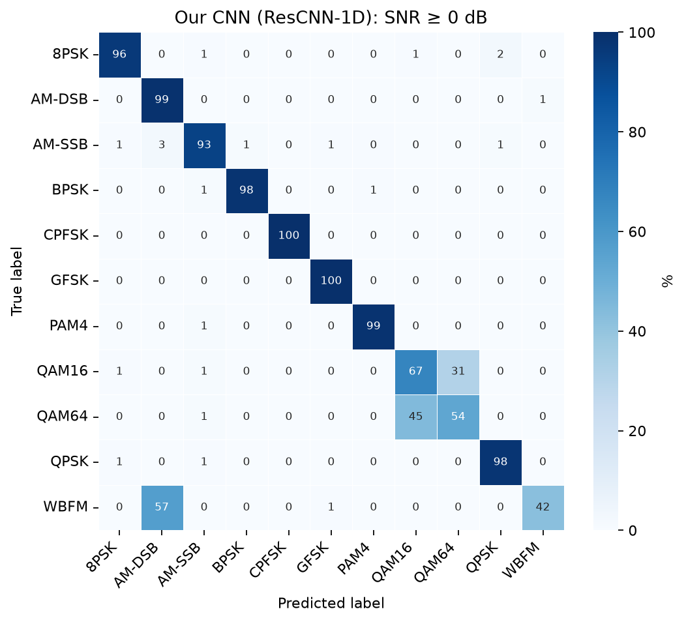

# The Complete Beginner's Guide to Our Project

**Recognising radio signal types with a CNN (Automatic Modulation Classification)**

Group 18 · ECE, NIT Agartala · Read this from top to bottom once. After that, you will be able to
explain every part of the project, answer Sir's questions, and run the demo.

---

## Part 1. The whole project in 60 seconds

Imagine you switch on a radio receiver and it catches some unknown signal from the air. Before you
can do anything with that signal, you must answer one basic question: **"What kind of signal is
this?"** Is it an FM radio station, a Bluetooth-style signal, a Wi-Fi-style signal?

Engineers call the "kind" of signal its **modulation**. Our project is a computer program that looks
at a tiny piece of a received signal (just **128 measurements**) and tells you which of **11
modulation types** it is. Nobody tells the program anything about who sent the signal. That is
called **blind** classification.

We built the program using **deep learning** (a **CNN**, a type of neural network). We compared it
with the **traditional method** that engineers have used for decades, and showed:

1. **Our CNN is much better when the signal is noisy.** At some noise levels it is right
   18 % more often.
2. **Nobody had to tell the CNN what to look for.** It learned by itself from examples.
3. **It beats the famous 2016 CNN (VT-CNN2)** at every noise level, while being 22 times smaller.
4. **It is fast.** One decision takes about 1.2 milliseconds on a normal laptop.

> **The 2-minute pitch you can say in the viva:**
> "When a receiver picks up an unknown radio signal, it first needs to know how the signal was
> modulated. Traditional methods use hand-made statistics and fail in noise. We trained a small
> convolutional neural network directly on raw I/Q samples from the RadioML 2016.10a dataset:
> 220,000 signal clips, 11 modulation types, noise levels from −20 to +18 dB. Our CNN reaches 86 %
> accuracy on reasonably clean signals and is up to 18 percentage points better than the traditional
> method in noisy conditions. It also beats the published VT-CNN2 model at every noise level (86 % vs
> 81 % on clean signals) with 22 times fewer parameters, and makes a decision in about 1.2
> milliseconds on a laptop CPU."

---

## Part 2. Radio basics (only what you need)

### 2.1 What is a radio signal?

A radio transmitter sends out a smooth, repeating wave called the **carrier** (think of a pure,
steady hum). A plain hum carries no information. To send information, the transmitter **changes
the wave** in some way. There are only three things you can change about a wave:

| You can change its... | Simple picture | Examples |
|---|---|---|
| **Amplitude** (how strong it is) | Turning a torch brighter and dimmer | AM radio, PAM4, QAM (partly) |
| **Frequency** (how fast it vibrates) | Whistling a higher or lower note | FM radio, FSK, Bluetooth |
| **Phase** (where in its cycle it is) | Two dancers in step, then one skips half a step | BPSK, QPSK, 8PSK, QAM (partly) |

**Modulation** is simply the *rule* for how the information changes the wave. Our job is to look at
the received wave and work out which rule was used.

### 2.2 The 11 signal types in our project

| Name | Type | What changes | In plain words | Used in real life |
|---|---|---|---|---|
| **BPSK** | Digital | Phase, 2 choices | Flips the wave upside down for 0 vs 1 | GPS, deep-space links |
| **QPSK** | Digital | Phase, 4 choices | 4 possible "angles", 2 bits at a time | Satellite TV, 4G |
| **8PSK** | Digital | Phase, 8 choices | 8 possible angles, 3 bits at a time | Satellite links |
| **PAM4** | Digital | Amplitude, 4 levels | 4 strength levels, 2 bits at a time | Fast Ethernet cables |
| **QAM16** | Digital | Amplitude + phase, 16 combos | A 4 × 4 grid of choices, 4 bits at a time | Wi-Fi, 4G, cable modems |
| **QAM64** | Digital | Amplitude + phase, 64 combos | An 8 × 8 grid, 6 bits at a time | Wi-Fi, 4G/5G |
| **CPFSK** | Digital | Frequency, 2 choices, smooth | Switches between two notes without jumps | Old modems, pagers |
| **GFSK** | Digital | Frequency, extra-smoothed | Like CPFSK but even smoother | **Bluetooth** |
| **AM-DSB** | Analog | Amplitude follows the voice | Classic AM radio | AM broadcast |
| **AM-SSB** | Analog | AM using half the bandwidth | AM with one "copy" removed to save space | Ham radio, aviation |
| **WBFM** | Analog | Frequency follows the voice | FM radio | FM stations (e.g. 91.1 MHz) |

**Digital** types send bits (0s and 1s). **Analog** types send a continuous signal, here recorded
speech. A digital signal sends one **symbol** (one choice) at a time. In our data each symbol lasts
8 measurements, so one clip of 128 measurements contains just **16 symbols**. Remember this number;
it explains one of our results later.

### 2.3 What are I/Q samples? (the most important idea)

The receiver measures the signal at regular moments in time. At each moment it does not record one
number but **two numbers, called I and Q**.

**The clock-hand picture:** imagine a clock hand that can grow, shrink and rotate.

- The **length** of the hand is the signal's **amplitude**.
- The **angle** of the hand is the signal's **phase**.
- **I** is how far the tip is to the **right**, and **Q** is how far it is **up**. They are just the
  x and y coordinates of the tip.

One clip in our dataset is **128 moments × 2 numbers = 256 numbers**. That is *all* the information
our program gets. Its whole job: "look at these 256 numbers and name the modulation".

If you plot every (I, Q) point of a clip as a dot, you get a **constellation diagram**. In a perfect
world, QPSK would show 4 neat dots, QAM16 a 4 × 4 grid of dots, and FSK a circle (its amplitude
never changes).



*Real examples from our dataset at +18 dB (clean). Top row: I (blue) and Q (orange) over time.
Bottom row: the constellation.*

Things to notice in this figure (good for the viva):

- The dots are **smeared paths, not neat points**. The transmitter smooths the jumps between
  symbols, so we also see the path *between* points. On top of that, a small frequency error slowly
  rotates everything.
- **CPFSK is a circle**, because FSK never changes the amplitude, only the angle.
- **BPSK and PAM4 are lines**: they only use one direction, tilted by a random angle.
- **AM-DSB and WBFM are both a single dot!** The speaker was silent in these clips, so both
  signals are just a plain, unchanging carrier and look *identical*. Remember this, too.

### 2.4 Noise and SNR (decibels made easy)

Every receiver also picks up random **noise** (like the hiss between radio stations). How hard the
problem is depends on how strong the signal is compared with the noise. This ratio is called
**SNR (Signal-to-Noise Ratio)** and is measured in **decibels (dB)**:

| SNR | Meaning |
|---|---|
| **+18 dB** | Signal is about 63 times stronger than the noise: very clean |
| **+10 dB** | Signal is 10 times stronger than the noise |
| **0 dB** | Signal and noise are **equally strong** |
| **−10 dB** | Noise is 10 times stronger than the signal |
| **−20 dB** | Noise is 100 times stronger: the signal is buried |

Rule of thumb: **every 10 dB = 10 times**, and **3 dB ≈ 2 times**. Our dataset covers −20 dB to
+18 dB in steps of 2 dB (20 noise levels).



*At −10 dB all 11 types look like the same random cloud to a human eye. Yet our CNN still gets 24 %
right here, against 9 % for blind guessing.*

### 2.5 Other real-world effects in the data

On top of noise, the dataset simulates what happens to real radio signals on the way to the
receiver:

- **Fading (multipath):** the signal bounces off buildings, and copies arrive slightly late and mix.
- **Frequency offset:** the transmitter's and receiver's "clocks" are never perfectly equal, so the
  constellation slowly spins.
- **Timing offset:** the receiver does not know exactly where each symbol starts.

These make the task realistic and harder.

---

## Part 3. The problem and the old ways of solving it

### 3.1 The problem in one line

> Given 256 numbers (128 I/Q samples) from an unknown transmitter, with noise and distortion, name
> which of the 11 modulation types was used.

### 3.2 Old way #1: likelihood-based (mentioned in our proposal, not built)

For each of the 11 types, calculate mathematically how likely it is that this type produced the
received samples, then pick the most likely. It is the best possible in theory, but it needs **exact
knowledge** of the channel (noise level, fading, frequency error). It is also **very slow** to
compute. In practice it is too heavy for real-time use. That is why our proposal only discusses it
and does not build it.

### 3.3 Old way #2: feature-based (we built this as our comparison)

An expert decides which **statistics** (called **features**) of the signal are useful, the
computer calculates them, and a simple classifier decides. We calculate **24 features**, for
example:

- **"How much does the amplitude change?"** PSK, FSK and FM keep the amplitude constant (small
  value). QAM and AM change it a lot (large value).
- **"How much does the frequency wander?"** Large for FSK and FM, small for PSK.
- **Higher-order cumulants:** more advanced statistics that act like a **fingerprint** of the
  constellation shape. For example, one of them (C40) is −2 for BPSK, +1 for QPSK and 0 for 8PSK.
  But it is −0.68 for QAM16 and −0.62 for QAM64, which are *almost the same*. This is a first hint of
  why those two get confused.

Then a classifier makes the decision:

- **Decision Tree:** a flowchart of yes/no questions learned from data, like "Is amplitude
  variation > 0.3? If yes, is frequency variation > 0.1? ...". Ours ended up 14 questions deep.
- **Random Forest:** **200 decision trees**, each trained on slightly different data, which then
  **vote**. Voting makes it more reliable than a single tree.

**The weakness:** noise messes up the statistics, so the features become unreliable at low SNR.
And for every new modulation, an expert has to invent new features.

---

## Part 4. Machine learning basics (no maths)

### 4.1 Learning from examples instead of rules

Traditional programming means a human writes the rules. **Machine learning** means we show the
computer thousands of examples **with the correct answer** ("this clip is QPSK", "this one is
WBFM"...), and it works out the rules by itself.

### 4.2 Training, validation and test sets (the exam analogy)

We split our 220,000 clips into three groups:

| Group | Size | Like... | Used for |
|---|---|---|---|
| **Training set** (60 %) | 132,000 clips | Textbook exercises | The model learns from these |
| **Validation set** (20 %) | 44,000 clips | Mock tests | Checking progress and deciding when to stop |
| **Test set** (20 %) | 44,000 clips | **The final exam** | Measuring the final score. **Never seen during training** |

The split is **stratified**: every combination of (signal type, noise level) is split 60/20/20, so
all types and noise levels are fairly represented. **All methods take exactly the same final
exam**, so the comparison is fair. This is why we can trust the results: a model cannot "cheat" by
memorising test clips it never saw.

### 4.3 What is a neural network?

A neural network is a big chain of very simple calculations. Each tiny unit (a "neuron") takes some
numbers, multiplies each by a **weight**, adds them up, and passes the result on, keeping it if it
is positive and making it zero if negative (this rule is called **ReLU**). The **weights** are the
network's adjustable knobs, called **parameters**. Our CNN has **125,451** of them, and VT-CNN2 has
**2,830,427**.

At the very end, the network outputs **11 numbers, one per signal type**. These are turned into
**probabilities that add up to 100 %** (this step is called **softmax**), for example "QPSK 94 %,
8PSK 4 %, ...". The highest one is the answer.

### 4.4 How training works

1. Show the network a small **batch** of 256 clips.
2. It guesses (probabilities for the 11 types).
3. Measure **how wrong** it was. This number is called the **loss** (we use *cross-entropy*:
   confident wrong answers are punished heavily).
4. Nudge every weight a tiny bit in the direction that reduces the loss. The method that does this
   is called **backpropagation**, and **Adam** is the rule for how big each nudge is. The overall
   nudge size is the **learning rate** (0.001).
5. Repeat for all 132,000 training clips. One full pass is one **epoch**. Then do it all again.

### 4.5 Overfitting, and how we prevented it

**Overfitting** = memorising instead of understanding, like a student who memorises answers to
exercises but fails the exam with new questions. We used three standard protections:

- **Validation set + early stopping:** after each epoch we check the mock test. When it has not
  improved for 8 epochs, we stop and **keep the best version**. Our CNN was best at epoch 18 and
  stopped at 26.
- **Dropout:** during training, randomly switch off some neurons, so the network cannot rely on any
  single one. It's like studying with random parts of your notes hidden.
- **Learning-rate reduction:** when progress stalls, take smaller steps (the learning rate is halved).

---

## Part 5. CNNs and our two models

### 5.1 What a convolution does

A **convolution filter** is a small window of weights, for example 3 samples long, that **slides
along the signal**. At every position it multiplies and adds, and gives a **high output where the
signal matches its pattern**. A filter shaped like "−1, +1" fires at sudden jumps, which is exactly
what a phase flip in BPSK looks like.

The magic: **we never design the filters**. The network starts with random filters, and training
shapes them into useful pattern detectors automatically. Our CNN has between 32 and 96 filters per
layer.

### 5.2 Stacking layers: from small patterns to big ones

- **First layers** see only a few samples and learn simple things: jumps, smooth curves, spikes.
- **Pooling** then shrinks the signal to half its length (keeping the strongest responses), so the
  next layer "sees" a longer stretch.
- **Deeper layers** combine simple patterns into complex ones: "smooth with constant amplitude"
  (FSK-like), "jumps between 4 angles" (QPSK-like), and so on.

### 5.3 Model 1: VT-CNN2 (the published benchmark, 2016)

The first famous CNN for this problem, by O'Shea, Corgan and Clancy (2016). It treats the 2 × 128
numbers like a tiny **image**: 2 convolution layers (256 and 80 filters), then a big **dense**
(fully connected) layer of 256 neurons, then the 11 outputs.

Its weak spot: the output of the convolutions (10,560 numbers) is connected to 256 neurons, and
**every connection is a parameter**. That single layer holds 2.7 million of its 2.83 million
parameters (95 %). This makes it big (34 MB) and slower.

### 5.4 Model 2: our ResCNN-1D (our contribution)

Our design choices, each in one line:

| Choice | What it means | Why |
|---|---|---|
| **1-D convolution, I and Q as 2 channels** | Each filter looks at I and Q *together* at each moment | It sees the whole "clock hand", not two separate shadows of it |
| **4 residual blocks** (32, 48, 64, 96 filters) | Deeper network: 9 convolution layers | More layers learn more complex patterns |
| **Residual (skip) connections** | Each block's output = its input + a learned correction | Lets deep networks train easily (the famous ResNet idea, He et al., 2016) |
| **Batch normalization** | Keeps numbers inside the network in a healthy range | Training is faster and more stable |
| **Max pooling** after each block | Halves the length: 128 → 64 → 32 → 16 → 8 | Later layers see longer stretches; less computation |
| **Global average + max pooling** | Summarises the whole clip into 192 numbers | **Replaces the giant dense layer**: this is why we have 22× fewer parameters |
| **Dropout 0.4, then 11 outputs + softmax** | Final decision with probabilities | Prevents overfitting |

Result: **125,451 parameters (22× fewer than VT-CNN2), a 1.7 MB file (vs 34 MB), and faster.**

---

## Part 6. What we actually did, step by step

| Step | What happened | Program |
|---|---|---|
| 1. Get the data | Downloaded RadioML 2016.10a from the Zenodo research archive (DeepSig's own site was broken). Checked its **MD5 checksum**, a "fingerprint" of the file that changes completely if even one byte differs. It matched exactly | (done once) |
| 2. Load safely | The file format (Python "pickle") can hide harmful code; our loader only accepts plain number arrays | `amc/data.py` |
| 3. Split | 60 / 20 / 20, stratified, fixed random seed so it is repeatable | `amc/data.py` |
| 4. Normalise | Scale every clip to the same average power, like setting the same volume. This is not a hand-made feature | `amc/data.py` |
| 5. Traditional method | 24 features, then a Decision Tree and a Random Forest | `scripts/train_feature_baseline.py` |
| 6. Our CNN | Trained 26 epochs (best at 18) in **18 minutes** on the laptop CPU | `scripts/train_cnn.py --model rescnn` |
| 7. VT-CNN2 | Same training. Stopped at epoch 43 (best at 35) after **132 minutes**: 7× longer than ours | `scripts/train_cnn.py --model vtcnn2` |
| 8. Speed test | Time per decision and model size | `scripts/benchmark_latency.py` |
| 9. Report | All graphs, tables and "did we meet our targets?" | `scripts/evaluate.py` |

Hardware: an ordinary laptop, AMD Ryzen 5 5600H CPU, 16 GB RAM, **no graphics card**.
Software: Python, TensorFlow/Keras, scikit-learn, NumPy, Matplotlib.

---

## Part 7. Our results and how to read them

### 7.1 The main graph: accuracy vs noise



**How to read it:** left = very noisy, right = clean. Higher = better. The dotted line at 9.1 % is
blind guessing (1 in 11). The graph has **three zones**:

1. **Hopeless zone (−20 to −12 dB):** noise is 15–100 times stronger than the signal. *Every*
   method is at about 9–15 %, close to guessing. Nothing can be done here.
2. **Battle zone (−10 to +6 dB): this is where our CNN wins big.**

| SNR | Traditional (best) | VT-CNN2 | **Our CNN** | Our gain over traditional |
|---|---|---|---|---|
| −8 dB | 28.6 % | 34.1 % | **38.0 %** | +9.4 |
| −6 dB | 38.4 % | 47.0 % | **53.3 %** | +14.9 |
| −4 dB | 48.8 % | 59.2 % | **66.7 %** | **+17.9** |
| −2 dB | 62.1 % | 70.2 % | **78.7 %** | +16.6 |
| 0 dB | 72.9 % | 77.3 % | **82.7 %** | +9.8 |

3. **Ceiling zone (+8 dB and cleaner):** our CNN and the Random Forest reach the **same ceiling of
   about 86–87 %**. VT-CNN2 stays lower, at about 82–83 %. Part 7.3 explains why nobody can go higher.

This is exactly what our proposal claimed: **deep learning is far more robust to noise than
hand-made features.** And our CNN beats the published VT-CNN2 at **every one** of the 15 noise
levels from −10 to +18 dB.

### 7.2 Summary table

| Method | Parameters | Overall | SNR ≥ 0 dB | At −10 dB | At 0 dB | At +18 dB | Best |
|---|---|---|---|---|---|---|---|
| Traditional: Decision Tree | – | 52.1 % | 81.0 % | 17.0 % | 66.3 % | 84.5 % | 85.4 % |
| Traditional: Random Forest | – | 54.3 % | 83.9 % | 19.2 % | 72.9 % | 86.8 % | 87.3 % |
| **Our CNN (ResCNN-1D)** | **125,451** | **58.8 %** | **86.1 %** | **24.1 %** | **82.7 %** | 86.1 % | **87.4 %** |
| VT-CNN2 (2016) | 2,830,427 | 55.1 % | 81.4 % | 22.8 % | 77.3 % | 82.2 % | 83.3 % |

Our CNN is best in every column except +18 dB, where it ties with the Random Forest.

**Why is "Overall" only 58.8 %?** It is the average over all 20 noise levels, including the
hopeless ones where everyone is at about 9 %. That is normal for this dataset; published papers
report similar numbers. Always quote **"86 % for SNR ≥ 0 dB"** together with the overall number.

### 7.3 Which signals get confused? (the confusion matrix)



**How to read it:** each **row** is the true type, and each **column** is what the model answered.
The numbers are percentages of each row. A perfect model would have 100 on the diagonal and 0
everywhere else.

- **9 of the 11 types are recognised 93–100 % of the time**: 8PSK, AM-DSB, AM-SSB, BPSK, CPFSK,
  GFSK, PAM4, QPSK all score 93 or more.
- **WBFM is called AM-DSB 57 % of the time.** The analog signals carry recorded speech, and during
  pauses in the speech both signals are just a plain carrier: the single dot in the figure of Part
  2.3. The clip simply **contains no information** to tell them apart, so *no* method can.
- **QAM16 and QAM64 swap 31–45 % of the time.** A clip has only **16 symbols**, far too few to
  reveal a 64-point grid. Noise blurs the closely packed points, and even their statistical
  fingerprints are nearly identical (C40 = −0.68 vs −0.62).

These two pairs are the **whole reason for the ~87 % ceiling**. Published research on this dataset
reports the same two confusions, so it is a property of the data, not a weakness of our model.

### 7.4 Speed and size

Measured on the laptop CPU (Ryzen 5 5600H), one clip at a time, as a live receiver would work:

| Method | Time per decision | Clips per second (in batches) | Model size |
|---|---|---|---|
| **Our CNN** | **1.16 ms** | **21,157** | **1.7 MB** |
| VT-CNN2 | 1.48 ms | 5,482 | 34 MB |
| Traditional: Decision Tree | 1.57 ms | 6,965 | 0.8 MB |
| Traditional: Random Forest | 25.7 ms | 4,185 | **1,306 MB (1.3 GB!)** |

- **Our CNN is the fastest of all four**, and almost 4× faster than VT-CNN2 in batches.
- The Random Forest is **22× slower** than our CNN and its file is **770× bigger**: it has to store
  200 large trees. So the "simple" traditional method is not even lightweight.
- The CNN times use XLA compilation, the standard way to deploy a TensorFlow model; the traditional
  times include computing the 24 features.

### 7.5 Did we meet our targets? (be honest about this)

| Target | Result |
|---|---|
| ≥ 85 % accuracy for SNR ≥ 0 dB | **Met: 86.1 %** |
| Under 5 ms per decision on a laptop | **Met: 1.16 ms** |
| Beat the traditional method at *every* SNR from −10 to +18 dB | **Almost: 13 of 15 levels.** At +10 and +18 dB the Random Forest is 0.3–0.6 points higher. Each noise level has 2,200 test clips, so random variation is about ±0.7 points: this difference is within noise. In the clean zone the honest statement is "they tie". |
| Beat VT-CNN2 with ≥ 10× fewer parameters | **Met: 86.1 % vs 81.4 %** (SNR ≥ 0 dB), better at all 15 noise levels from −10 to +18 dB, with **22.6× fewer parameters** |

**Never hide the "almost".** Examiners respect honest results far more than perfect-looking ones.

---

## Part 8. Limitations and future work (examiners always ask)

**Limitations:**

1. **The dataset is computer-generated (simulated with GNU Radio).** Real hardware adds effects that
   may not be fully captured, such as amplifier distortion and I/Q imbalance.
2. **Only 11 fixed types.** A signal type it has never seen will be forced into one of the 11.
3. **Short clips (128 samples, 16 symbols)** limit how well dense types like QAM64 can be recognised.
4. **The ~87 % ceiling** from the two confusing pairs.

**Future work:**

1. Test with **real radio hardware** (a software-defined radio such as an RTL-SDR or USRP).
2. **Longer clips**, or combining several clips, to separate QAM16 from QAM64.
3. Newer architectures (CNN + LSTM, transformers) and **data augmentation** (rotating signals during
   training).
4. Running the model on a **phone or a small board** (e.g. Raspberry Pi) for a real portable receiver.

<div class="pb"></div>

## Part 9. Viva questions with simple answers

**Q1. What is your project in one sentence?**
A CNN that identifies which of 11 modulation types a received radio signal uses, from just 128 raw
I/Q samples, with no knowledge of the transmitter.

**Q2. Why is this useful?**
Cognitive radio (finding and using free spectrum), spectrum monitoring by regulators, finding
interference, security and defence (identifying unknown transmitters), and flexible receivers that
adapt to any standard.

**Q3. What are I/Q samples?**
At each instant the receiver records two numbers, the in-phase (I) and quadrature (Q) components.
Together they give the signal's amplitude and phase. Picture them as the x and y coordinates of a
rotating clock hand.

**Q4. What does SNR = −10 dB mean?**
The noise is 10 times stronger than the signal. 0 dB means equal strength, and +10 dB means the
signal is 10 times stronger.

**Q5. Why a CNN?**
CNNs learn their own pattern detectors from data, so no expert has to design features. They are
also good at finding local patterns (like phase jumps) anywhere in the signal, and they proved much
more robust to noise in our results.

**Q6. What is a convolution?**
A small window of learned weights that slides along the signal and responds strongly wherever the
signal matches its pattern.

**Q7. Why 1-D convolution and not 2-D like VT-CNN2?**
The signal is a time series with two channels (I and Q). A 1-D convolution looks at I and Q
together at every moment, which matches the physics: amplitude and phase depend on both.

**Q8. What is a residual connection?**
A shortcut that adds a block's input to its output, so the block only needs to learn a correction.
It makes deeper networks much easier to train (ResNet, He et al., 2016).

**Q9. Why does your model have 22× fewer parameters than VT-CNN2?**
VT-CNN2 connects 10,560 numbers to a 256-neuron dense layer: 2.7 M weights. We use global pooling to
summarise the clip into 192 numbers first, so our dense layer needs only about 25 k weights.

**Q10. Why does accuracy stop at about 87 % even for clean signals?**
Two pairs are nearly impossible to separate in this dataset: WBFM vs AM-DSB (speech pauses make
both a plain carrier) and QAM16 vs QAM64 (only 16 symbols per clip, closely packed points). Every
published method hits the same ceiling.

**Q11. Why is accuracy only about 9 % at −20 dB?**
The noise is 100 times stronger than the signal, so there is essentially no information left. 9 %
is the same as guessing among 11 types. Every method in the literature shows this.

**Q12. How do you know the model is not just memorising?**
The test set (44,000 clips) is never used during training, and the final score comes only from
it. During training we watched a separate validation set. At the best epoch (18), training accuracy
was 60.5 % and validation 58.7 %, very close. After that, training accuracy kept rising (64 % by
epoch 26) but validation did not. That is the start of memorising, so early stopping kept the epoch-18
version. Dropout also helps.

**Q13. Why is the split stratified?**
So every signal type and every noise level appears in the same proportion in training, validation
and test. No type or noise level is over- or under-represented.

**Q14. Where is the data from? Is it real?**
RadioML 2016.10a by DeepSig (O'Shea et al., 2016), the standard benchmark for this problem. It is
simulated with GNU Radio, including realistic fading, frequency and timing offsets, and noise. We
downloaded a checksum-verified copy from the Zenodo research archive.

**Q15. What hardware did you use and how long did training take?**
A normal laptop with a Ryzen 5 5600H CPU and no GPU. Our CNN trained in 18 minutes; VT-CNN2 took
132 minutes, 7× longer, because it is much heavier.

**Q16. Is it fast enough for real use?**
Yes. About 1.2 ms per decision on a laptop CPU, so roughly 850 decisions per second one at a time,
and about 21,000 per second in batches.

**Q17. What is the traditional method you compared with?**
24 hand-made features (higher-order cumulants, amplitude/phase/frequency statistics, spectral
features) fed to a Decision Tree and a Random Forest. It represents the "feature-based" approach in
our proposal.

**Q18. Why did the CNN win in noise but tie when clean?**
Hand-made statistics get distorted by noise, while the CNN learned to look at many subtle patterns
at once. When signals are clean, both reach the data's ceiling, set by the two confusing pairs.

**Q19. What is overfitting and how did you prevent it?**
Memorising training examples instead of learning general patterns. We prevented it with a validation
set, early stopping (best epoch kept), dropout, and learning-rate reduction.

**Q20. Why does your CNN beat VT-CNN2?**
It is deeper (9 convolution layers vs 2), and residual connections and batch normalization let that
depth train well. Its 1-D filters see I and Q together. And global pooling replaces VT-CNN2's huge
dense layer, which mostly adds parameters that can memorise. VT-CNN2's gap between training and
validation accuracy at its best epoch was larger (58.6 % vs 54.9 %) than ours (60.5 % vs 58.7 %).

**Q21. Why does the Random Forest beat VT-CNN2 on clean signals?**
On clean signals, well-chosen statistics work well, and VT-CNN2 is a small, early design. This shows
that "deep learning" is not automatically better: the network design matters. Our design beats both.

**Q22. What would you do with more time?**
Test on real SDR hardware, use longer clips to separate QAM16/QAM64, try CNN + LSTM models, and run
the model on a small embedded board.

---

## Part 10. How to run things (commands)

Open PowerShell in the project folder (`C:\Users\kumar\college+project`), then:

```powershell
.venv\Scripts\Activate.ps1                        # switch on the project's Python (once per window)
python scripts\predict.py                         # LIVE DEMO: 10 random test clips
python scripts\predict.py --snr 10 --n 12         # 12 clips at +10 dB
python scripts\predict.py --plot                  # also saves a picture of the predictions
python scripts\evaluate.py --dataset rml2016a     # rebuild all graphs + REPORT.md
```

All results live in `results\rml2016a\`. The most important files are `REPORT.md`,
`accuracy_vs_snr.png` and `rescnn\confusion_snr_ge_0.png`.

---

## Part 11. Glossary (quick lookup)

| Term | Meaning |
|---|---|
| **Modulation** | The rule for changing a radio wave (amplitude, frequency or phase) to carry information |
| **Carrier** | The plain, steady wave that gets modulated |
| **Symbol** | One "choice" sent by a digital signal (e.g. one of 4 angles in QPSK) |
| **I/Q samples** | Two numbers per instant (x and y of the "clock hand") giving amplitude and phase |
| **Constellation** | Plot of all I/Q points; each modulation has its own shape |
| **SNR / dB** | Signal strength vs noise strength; every 10 dB = 10 times |
| **AMC** | Automatic Modulation Classification: our problem |
| **Feature** | A hand-made statistic of the signal (traditional approach) |
| **Cumulant** | An advanced statistic that acts as a fingerprint of the constellation shape |
| **Decision Tree / Random Forest** | A flowchart of learned yes/no questions / 200 such trees voting |
| **Neural network** | A chain of simple calculations with adjustable weights |
| **Parameter (weight)** | One adjustable number inside the network |
| **CNN** | Convolutional Neural Network: learns sliding pattern detectors |
| **Filter** | One learned pattern detector |
| **Pooling** | Shrinking the signal while keeping the strongest responses |
| **Residual connection** | A shortcut that adds a block's input to its output |
| **Batch normalization** | Keeps numbers inside the network in a healthy range |
| **Dropout** | Randomly switching off neurons during training to prevent memorising |
| **Softmax** | Turns the 11 output scores into probabilities that add up to 100 % |
| **Loss (cross-entropy)** | A number measuring how wrong the predictions are |
| **Epoch** | One full pass over all training clips |
| **Learning rate** | How big each correction step is during training |
| **Early stopping** | Stop training when the validation score stops improving; keep the best |
| **Overfitting** | Memorising training data instead of learning general patterns |
| **Train / validation / test** | Exercises / mock tests / final exam |
| **Stratified split** | Every (type, noise level) combination is split in the same ratio |
| **Confusion matrix** | Table of true type vs predicted type |
| **Latency** | Time for one decision |
| **XLA** | A TensorFlow compiler that fuses layers so the model runs faster |
| **MD5 checksum** | A file "fingerprint" used to check the download is exactly right |
