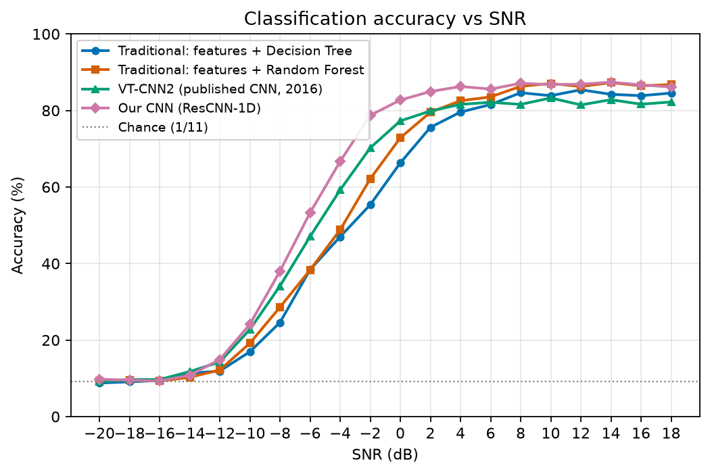
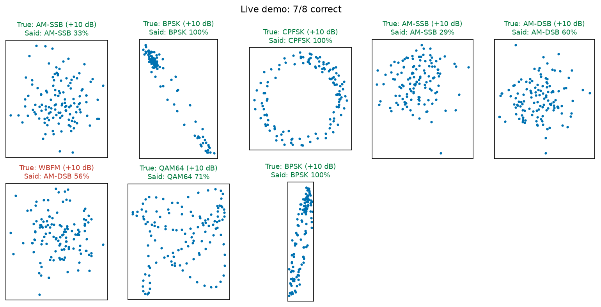
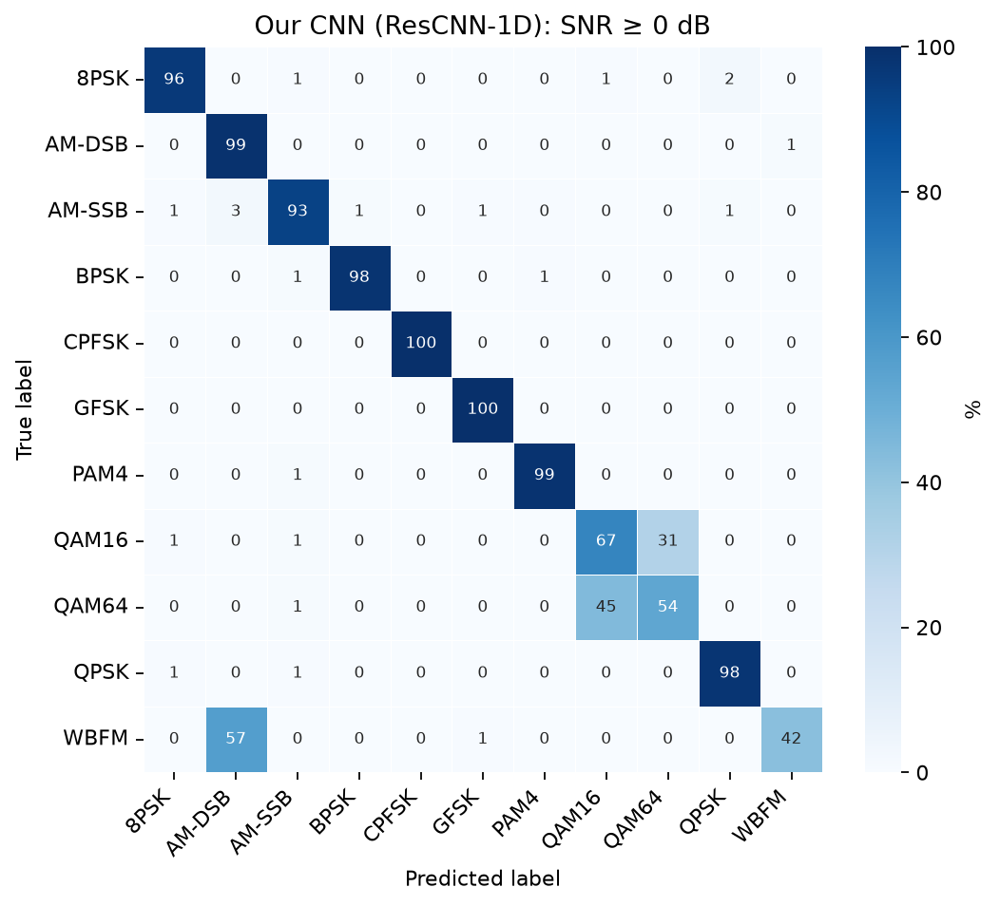

# Automatic Modulation Classification with a Lightweight CNN

**Recognising the modulation type of an unknown radio signal from 128 raw I/Q samples, using deep learning.**

Pre-final year project · Department of Electronics and Communication Engineering, NIT Agartala · Group 18
Supervisor: **Dr. Ashish Kumar Padhan** · Course theme: *AI and ML in Wireless Communications*

A receiver hears a short piece of an unknown radio signal: 128 time samples, each an in-phase (I) and
quadrature (Q) value. Without any help from the transmitter, it has to say which of 11 modulation types it
is. This is **blind Automatic Modulation Classification (AMC)**, used in spectrum monitoring, cognitive
radio and electronic warfare.

We compare three approaches on the public **RadioML 2016.10a** benchmark, all tested on the same 44,000
unseen clips:

| Approach | Idea |
|---|---|
| Traditional: features + Decision Tree / Random Forest | 24 hand-crafted statistics (cumulants, amplitude/phase/frequency spread, spectral peaks), then a classical classifier |
| VT-CNN2 (O'Shea et al., 2016) | The first well-known CNN for this problem: 2.83 M parameters |
| **ResCNN-1D (ours)** | A small residual 1-D CNN: **125 k parameters, 22.6× fewer than VT-CNN2** |

---

## Contents

1. [Key results](#1-key-results)
2. [Repository layout](#2-repository-layout)
3. [Setup](#3-setup)
4. [Getting the dataset](#4-getting-the-dataset)
5. [Running the experiments](#5-running-the-experiments)
6. [Live demo](#6-live-demo)
7. [Method in detail](#7-method-in-detail)
8. [Detailed results](#8-detailed-results)
9. [Reproducibility and timings](#9-reproducibility-and-timings)
10. [Limitations and future work](#10-limitations-and-future-work)
11. [Project documents](#11-project-documents)
12. [Team](#12-team)
13. [References](#13-references)

---

## 1. Key results



| Method | Parameters | Overall (all 20 SNRs) | SNR ≥ 0 dB | At −10 dB | At 0 dB | At +18 dB | Time per decision | Model file |
|---|---|---|---|---|---|---|---|---|
| Traditional: Decision Tree | – | 52.1 % | 81.0 % | 17.0 % | 66.3 % | 84.5 % | 1.57 ms | 0.76 MB |
| Traditional: Random Forest | – | 54.3 % | 83.9 % | 19.2 % | 72.9 % | 86.8 % | 25.70 ms | 1,306 MB |
| VT-CNN2 (2016) | 2,830,427 | 55.1 % | 81.4 % | 22.8 % | 77.3 % | 82.2 % | 1.48 ms | 34.0 MB |
| **ResCNN-1D (ours)** | **125,451** | **58.8 %** | **86.1 %** | **24.1 %** | **82.7 %** | **86.1 %** | **1.16 ms** | **1.69 MB** |

**Targets set before the experiments, and the outcome:**

| Target | Result | Met? |
|---|---|---|
| ≥ 85 % accuracy for SNR ≥ 0 dB | 86.1 % | ✅ Yes |
| At least as accurate as VT-CNN2 with ≥ 10× fewer parameters | 86.1 % vs 81.4 %, 22.6× fewer parameters; better at **all 15** SNR levels from −10 to +18 dB | ✅ Yes |
| < 5 ms per decision on a laptop CPU | 1.16 ms (the fastest of the four methods) | ✅ Yes |
| More accurate than the traditional method at every SNR from −10 to +18 dB | Better at **13 of 15** levels, by up to 17.9 points (−4 dB: 66.7 % vs 48.8 %). At +10 and +18 dB, tied with the Random Forest within 0.7 points (about one standard error) | ⚠️ Almost |

**In one sentence:** the small residual CNN is the most accurate method overall and the fastest. Its
biggest gains are in the noisy −10 to 0 dB range, where a real receiver struggles most.

---

## 2. Repository layout

```
College-project/
├── amc/                         Python package with all the core code
│   ├── __init__.py              class list (11 modulations), default seed 2026
│   ├── data.py                  safe dataset loader, stratified 60/20/20 split, power normalisation
│   ├── features.py              the 24 hand-crafted features (traditional method)
│   ├── models.py                VT-CNN2 and ResCNN-1D (TensorFlow / Keras)
│   ├── metrics.py               accuracy vs SNR, confusion matrices, summaries
│   ├── plots.py                 every figure (colour-blind-safe palette)
│   ├── synth.py                 RadioML-style signal generator, for testing without the dataset
│   └── utils.py                 folders, JSON, seeds, model ordering
├── scripts/                     command-line entry points (see section 5)
│   ├── run_all.py               runs the whole pipeline in order
│   ├── visualize_dataset.py     example waveforms and constellations
│   ├── train_feature_baseline.py   features + Decision Tree / Random Forest
│   ├── train_cnn.py             trains VT-CNN2 or ResCNN-1D
│   ├── benchmark_latency.py     speed and model-size test
│   ├── evaluate.py              comparison figures, CSVs and REPORT.md
│   ├── predict.py               live demo on random unseen test clips
│   ├── generate_synthetic.py    writes data/synthetic_rml.npz
│   └── wait_for_dataset_and_run.ps1   helper that starts the full run once the dataset appears
├── results/rml2016a/            all final results (figures, tables, trained models, REPORT.md)
├── GUIDE.md / GUIDE.pdf         beginner's guide to the whole project, with viva questions
├── PLAN.md / PLAN.pdf           project plan in plain language
├── Group18_AMC_Presentation.pptx   final presentation (22 slides, with speaker notes)
├── requirements.txt
└── README.md
```

Not included in the repository (see [section 9](#9-reproducibility-and-timings)): the dataset (`data/`),
the 1.3 GB Random Forest model file, the cached feature and split files, and the code-check runs.

---

## 3. Setup

**Requirements:** Python 3.10 or newer (tested on 3.13), about 4 GB of free disk space and 8 GB of RAM
(16 GB recommended). **No GPU needed:** everything was trained on a laptop CPU.

**Windows (PowerShell):**

```powershell
git clone https://github.com/rajkumar0932/College-project.git
cd College-project
python -m venv .venv
.venv\Scripts\Activate.ps1
pip install -r requirements.txt
```

**Linux / macOS:**

```bash
git clone https://github.com/rajkumar0932/College-project.git
cd College-project
python3 -m venv .venv
source .venv/bin/activate
pip install -r requirements.txt
```

Libraries used: TensorFlow/Keras (CNNs), NumPy and SciPy (signal processing), scikit-learn (Decision
Tree / Random Forest), pandas (tables), Matplotlib and Seaborn (figures), h5py.

> If PowerShell refuses to run `Activate.ps1`, run
> `Set-ExecutionPolicy -Scope CurrentUser RemoteSigned` once, then try again.

---

## 4. Getting the dataset

The project uses **RadioML 2016.10a** by DeepSig (O'Shea and West, 2016): 220,000 clips covering
11 modulations × 20 SNR levels × 1,000 clips. The dataset is licensed **CC BY-NC-SA 4.0**, so it is not
copied into this repository. Download it from one of the two sources below.

**Option A: the official DeepSig site.** Open
`https://opendata.deepsig.io/datasets/2016.10/RML2016.10a.tar.bz2`, fill in DeepSig's short form and
follow the emailed link. Then extract the archive:

```powershell
mkdir data -Force
tar -xjf $HOME\Downloads\RML2016.10a.tar.bz2 -C data
```

**Option B: the Zenodo research archive.** We used this source because DeepSig's site had an expired
certificate and its form returned errors in November 2026.

1. Open <https://zenodo.org/records/18397070> (DOI `10.5281/zenodo.18397070`) and download
   `RML2016.10a_dict_optimized.pkl`.
2. Check that the file is intact. The MD5 must be `ffedb2c24e33b826d3d0df4aa8f32c1b`:
   ```powershell
   Get-FileHash RML2016.10a_dict_optimized.pkl -Algorithm MD5     # Windows
   md5sum RML2016.10a_dict_optimized.pkl                          # Linux
   ```
3. Move it to `data/RML2016.10a_dict.pkl`.

Either way, the result must be **`data/RML2016.10a_dict.pkl`**. To use another location, pass
`--data-path <file>` to any script.

> **Safety:** the dataset is a Python pickle, and pickles can run code when loaded. Our loader
> (`amc/data.py`) uses a restricted unpickler that only accepts NumPy arrays and refuses everything else.
> It also checks that every entry has shape 2 × 128 and a known modulation name.

---

## 5. Running the experiments

### Everything at once

```powershell
python scripts\run_all.py --dataset rml2016a
```

This runs six steps in order. When it finishes, open **`results\rml2016a\REPORT.md`**.

| Step | Script | What it does | Time on our laptop |
|---|---|---|---|
| 1 | `visualize_dataset.py` | One example of each modulation at +18, 0 and −10 dB | 0.2 min |
| 2 | `train_feature_baseline.py` | 24 features → Decision Tree + Random Forest | 1.5 min |
| 3 | `train_cnn.py --model rescnn` | Trains our CNN | 18 min |
| 4 | `train_cnn.py --model vtcnn2` | Trains VT-CNN2 | 132 min |
| 5 | `benchmark_latency.py` | Speed and size of every model | 0.6 min |
| 6 | `evaluate.py` | Comparison figures, CSVs and REPORT.md | 0.2 min |

Useful options for `run_all.py`:

| Option | Meaning |
|---|---|
| `--skip-vtcnn2` | Skip the slowest model (saves about 2 hours) |
| `--epochs N` | Maximum training epochs (default 60; early stopping usually ends sooner) |
| `--batch-size N` | Training batch size (default 256) |
| `--data-path FILE` | Dataset in a non-default location |
| `--quick` | Tiny run that only checks the code works (results go to `results_quick/`) |

### Step by step

```powershell
python scripts\visualize_dataset.py      --dataset rml2016a
python scripts\train_feature_baseline.py --dataset rml2016a
python scripts\train_cnn.py --model rescnn --dataset rml2016a
python scripts\train_cnn.py --model vtcnn2 --dataset rml2016a
python scripts\benchmark_latency.py      --dataset rml2016a
python scripts\evaluate.py               --dataset rml2016a
```

`train_cnn.py` also accepts `--epochs`, `--batch-size`, `--lr`, `--patience`, `--seed`, `--augment`
(random phase rotation) and `--tag` (a name for the output folder). Run any script with `--help` to see
all its options.

### Checking the code without the dataset

`amc/synth.py` generates signals in the same format as RadioML: the same 11 modulations, 8 samples per
symbol, fading, frequency and timing offsets, and noise. Use it to check that everything runs:

```powershell
python scripts\run_all.py --dataset synthetic --quick      # about 2–3 minutes
```

These results are only a code check. They go to `results_quick/` and are not part of our findings.

### Outputs (in `results/rml2016a/`)

| File | Contents |
|---|---|
| `REPORT.md` | Plain-language summary: main graph, summary table, targets check, confusions, speed |
| `accuracy_vs_snr.png` / `.csv` | **Main result**: accuracy of every method at every SNR |
| `summary.csv` | One row per method (the table in section 1) |
| `best_per_class_accuracy.png` | Accuracy of each modulation vs SNR (our CNN) |
| `best_confusion_18dB.png`, `best_confusion_0dB.png`, `best_confusion_-10dB.png` | Confusion matrices of our CNN at three noise levels |
| `<model>/confusion_all_snr.png`, `<model>/confusion_snr_ge_0.png` | Confusion matrices for every method |
| `<model>/metrics.json` | Accuracy at every SNR, parameters, epochs, training time |
| `<model>/test_predictions.npz` | True label, predicted label and SNR for all 44,000 test clips |
| `<model>/training_curves.png`, `training_log.csv`, `history.json` | Loss and accuracy per epoch (CNNs) |
| `<model>/model_summary.txt` | Layer-by-layer Keras summary (CNNs) |
| `<model>/model.keras`, `feat_dt/model.joblib` | Trained models |
| `feat_rf/feature_importance.png` | Which features the Random Forest relied on |
| `latency.json` | Speed and size measurements, with the system they were measured on |
| `dataset_examples_*dB.png` | Example waveform and constellation of every modulation |

---

## 6. Live demo

The demo picks random clips from the **test set** (clips the model never saw during training) and shows
the true type, the model's answer and its confidence:

```powershell
python scripts\predict.py                       # 10 random clips at any SNR
python scripts\predict.py --snr 10 --n 8        # 8 clips at +10 dB
python scripts\predict.py --snr -10             # see how noise makes it harder
python scripts\predict.py --plot                # also saves results\rml2016a\demo_predictions.png
python scripts\predict.py --model vtcnn2        # use VT-CNN2 instead of our CNN
```

Example output (seed 1, +10 dB):

```
 #     SNR  True type  Predicted  Confidence  Result
----------------------------------------------------------
 1   +10 dB  AM-SSB     AM-SSB           33.2%  correct
 2   +10 dB  BPSK       BPSK            100.0%  correct
 3   +10 dB  CPFSK      CPFSK           100.0%  correct
 ...
 6   +10 dB  WBFM       AM-DSB           55.6%  WRONG
----------------------------------------------------------
Score: 7/8 correct
```



---

## 7. Method in detail

### 7.1 Data and pre-processing

* **Input:** each clip is a complex baseband signal of 128 samples, stored as a 2 × 128 array (I and Q).
  At 8 samples per symbol, a clip holds 16 symbols.
* **Split:** stratified by (modulation, SNR) into **60 % training (132,000)**, **20 % validation
  (44,000)** and **20 % test (44,000)**, with seed 2026. Every method uses exactly the same split. The
  validation set is only used for early stopping and for choosing the Decision Tree depth. The test set
  is used once, for the final numbers.
* **Normalisation:** every clip is scaled to unit RMS power, so the models cannot cheat by using signal
  strength. The CNNs see the clip as a 128 × 2 sequence.

### 7.2 Traditional method (features + classifier)

24 features are computed from each normalised clip, in three groups of eight:

| Group | Features |
|---|---|
| Higher-order cumulants (Swami and Sadler) | \|C20\|, \|C40\|, \|C41\|, \|C42\|, \|C60\|, \|C61\|, \|C62\|, \|C63\| |
| Amplitude, phase and frequency statistics (Azzouz and Nandi) | γ<sub>max</sub>, σ<sub>aa</sub>, σ<sub>a</sub>, kurtosis of amplitude, σ<sub>ap</sub>, σ<sub>dp</sub>, σ<sub>af</sub>, σ<sub>f</sub> |
| Spectral and shape | \|mean x\|, spectral peaks of x, x² and x⁴, spectral flatness, PAPR, kurtosis of I and of Q |

The two classifiers:

* **Decision Tree:** depth chosen from {6, 10, 14, 18, unlimited} on the validation set. Depth 14 was chosen.
* **Random Forest:** 200 trees, minimum 2 samples per leaf.

### 7.3 VT-CNN2 (reference CNN)

This follows O'Shea, Corgan and Clancy (2016). It treats the clip as a 2 × 128 single-channel image.

| Layer | Output | Parameters |
|---|---|---|
| Conv2D 256 filters, 1 × 3, ReLU, dropout 0.5 | 2 × 130 × 256 | 1,024 |
| Conv2D 80 filters, 2 × 3, ReLU, dropout 0.5 | 1 × 132 × 80 | 122,960 |
| Flatten → Dense 256, ReLU, dropout 0.5 | 256 | **2,703,616** (95.5 %) |
| Dense 11, softmax | 11 | 2,827 |
| **Total** | | **2,830,427** |

### 7.4 ResCNN-1D (proposed)

I and Q are the two input channels of a **1-D convolution over time**, so every filter sees both together.

| Stage | Details | Output |
|---|---|---|
| Stem | Conv1D 32 filters, kernel 7 → BatchNorm → ReLU | 128 × 32 |
| Residual block 1 + max-pool ÷2 | 32 filters | 64 × 32 |
| Residual block 2 + max-pool ÷2 | 48 filters | 32 × 48 |
| Residual block 3 + max-pool ÷2 | 64 filters | 16 × 64 |
| Residual block 4 + max-pool ÷2 | 96 filters | 8 × 96 |
| Global average pool ‖ global max pool | concatenated | 192 |
| Dense 128, ReLU → dropout 0.4 | | 128 |
| Dense 11, softmax | | 11 |
| **Total** | | **125,451 parameters** |

Each **residual block** is Conv1D(k=3) → BN → ReLU → Conv1D(k=3) → BN. The input is added back through
a shortcut (a 1 × 1 convolution with BN when the width changes), followed by ReLU. The shortcuts make the
deeper stack easy to train (He et al., 2016).

Global pooling replaces VT-CNN2's huge flatten-and-dense layer. That removes about 95 % of the parameters
and makes the model fast.

### 7.5 Training settings (both CNNs)

| Setting | Value |
|---|---|
| Optimiser | Adam, learning rate 0.001 |
| Learning-rate schedule | Halved when validation loss stalls for 4 epochs (minimum 1e-5) |
| Loss | Sparse categorical cross-entropy |
| Batch size | 256 |
| Epochs | Up to 60. Early stopping on validation loss (patience 8) restores the best weights |
| Seed | 2026 (split, initialisation, shuffling) |

### 7.6 How speed was measured

* **Time per decision:** one clip at a time (batch size 1), mean of 300 runs after 20 warm-up runs.
* **Throughput:** 1,024 clips at once.
* CNNs are compiled with XLA (`tf.function(jit_compile=True)`), the normal way to deploy a TensorFlow
  model. Without XLA, our CNN takes 2.11 ms and VT-CNN2 1.66 ms.
* Traditional-method times **include** computing the 24 features.

---

## 8. Detailed results

### 8.1 Accuracy (%) at every SNR (test set, 2,200 clips per SNR)

| SNR (dB) | Decision Tree | Random Forest | VT-CNN2 | **ResCNN-1D (ours)** |
|---|---|---|---|---|
| −20 | 8.8 | 9.3 | 9.1 | 9.8 |
| −18 | 9.1 | 9.6 | 9.7 | 9.5 |
| −16 | 9.5 | 9.3 | 9.7 | 9.3 |
| −14 | 11.3 | 10.3 | 11.8 | 10.8 |
| −12 | 11.9 | 12.2 | 14.3 | **14.9** |
| −10 | 17.0 | 19.2 | 22.8 | **24.1** |
| −8 | 24.6 | 28.6 | 34.1 | **38.0** |
| −6 | 38.4 | 38.3 | 47.1 | **53.3** |
| −4 | 47.0 | 48.8 | 59.2 | **66.7** |
| −2 | 55.4 | 62.1 | 70.2 | **78.7** |
| 0 | 66.3 | 72.9 | 77.3 | **82.7** |
| +2 | 75.6 | 79.6 | 79.9 | **85.0** |
| +4 | 79.6 | 82.6 | 81.6 | **86.3** |
| +6 | 81.6 | 83.6 | 82.1 | **85.6** |
| +8 | 84.6 | 86.3 | 81.6 | **87.1** |
| +10 | 83.9 | **87.1** | 83.3 | 86.8 |
| +12 | 85.4 | 86.3 | 81.5 | **86.9** |
| +14 | 84.2 | 87.3 | 82.8 | **87.4** |
| +16 | 83.9 | 86.5 | 81.6 | **86.7** |
| +18 | 84.6 | **86.8** | 82.2 | 86.1 |

Random guessing among 11 types gives 9.1 %. Below about −12 dB every method is near guessing, because
the noise is more than ten times stronger than the signal.

### 8.2 Which modulations get confused?



For SNR ≥ 0 dB, 9 of the 11 types are recognised 93–100 % correctly. The remaining errors are almost all
in two pairs:

| True type | Mistaken for | How often | Reason |
|---|---|---|---|
| WBFM | AM-DSB | 57.0 % | The analog signals carry recorded speech. During pauses both reduce to a plain carrier and are identical in the data |
| QAM64 | QAM16 | 44.5 % | Dense constellations: with only 16 symbols per clip, the 64-point grid is barely sampled |
| QAM16 | QAM64 | 31.3 % | Same reason |
| AM-SSB | AM-DSB | 2.6 % | |
| 8PSK | QPSK | 2.4 % | QPSK's 4 phases are a subset of 8PSK's 8 phases |

Published results on RadioML 2016.10a report the same two confusions, so they come from the dataset and
not from a bug in our model.

### 8.3 Speed and size (AMD Ryzen 5 5600H laptop CPU, no GPU)

| Method | One decision (mean) | One decision (95th percentile) | Throughput | Model file |
|---|---|---|---|---|
| Decision Tree | 1.57 ms | 2.14 ms | 6,965 clips/s | 0.76 MB |
| Random Forest | 25.70 ms | 32.05 ms | 4,185 clips/s | 1,306 MB |
| VT-CNN2 | 1.48 ms | 1.84 ms | 5,482 clips/s | 34.0 MB |
| **ResCNN-1D (ours)** | **1.16 ms** | **1.49 ms** | **21,157 clips/s** | **1.69 MB** |

Our CNN is 22× faster than the Random Forest and its file is 770× smaller. It also has 3.9× the
throughput of VT-CNN2.

### 8.4 Training

| Model | Epochs run | Best epoch | Training time |
|---|---|---|---|
| ResCNN-1D | 26 | 18 | 18 min |
| VT-CNN2 | 43 | 35 | 132 min |

The training curves are in `results/rml2016a/<model>/training_curves.png`.

---

## 9. Reproducibility and timings

* **Fixed seed (2026)** for the data split, model initialisation and shuffling. Re-running gives the same
  split. CNN accuracies may still move by a few tenths of a percent between machines and TensorFlow
  versions.
* **Measured on:** AMD Ryzen 5 5600H (6 cores), 16 GB RAM, no GPU, Windows 11, Python 3.13,
  TensorFlow 2.21.
* **Full run time:** about 2.5 hours (152.7 min), almost all of it VT-CNN2. One VT-CNN2 epoch took
  36 minutes instead of the usual 2.5, probably because the laptop went idle. Without that, the run
  would take about 2 hours.
* **Not in the repository, recreated by the scripts:**
  * `results/rml2016a/feat_rf/model.joblib`: the Random Forest model, 1.3 GB, too big for GitHub.
    `train_feature_baseline.py` recreates it in about a minute. All its results (predictions, metrics,
    figures) *are* included.
  * `results/*/features.npz` and `results/*/split.npz`: caches recreated on the first run.
  * `data/`: download it as in section 4.
* **Integrity check:** `test_predictions.npz` for every model is included, so all tables and figures can
  be rebuilt with `python scripts\evaluate.py` without retraining.

---

## 10. Limitations and future work

**Limitations**

* **Simulated data.** RadioML 2016.10a is generated in GNU Radio, not recorded over the air.
* **Closed set.** A modulation outside the 11 known types is still forced into one of them.
* **Short clips.** 128 samples (16 symbols) are too few to separate QAM16 from QAM64 reliably.
* **Low SNR.** Below about −10 dB every method is near guessing. This is a physical limit.
* **Single run.** One training run per model. Per-SNR differences under about 1 point are within noise.

**Future work**

* Test on real over-the-air signals captured with a software-defined radio (SDR).
* Data augmentation (random phase rotation is already implemented: `train_cnn.py --augment`) and
  longer clips.
* The larger RadioML 2018.01A dataset (24 modulations, 1,024 samples per clip).
* CNN + LSTM or transformer models.
* Deployment on a phone or embedded board with TensorFlow Lite.

---

## 11. Project documents

| Document | For |
|---|---|
| [GUIDE.pdf](GUIDE.pdf) ([GUIDE.md](GUIDE.md)) | A beginner's explanation of the whole project, from radio basics to results, with 22 likely viva questions and answers |
| [PLAN.pdf](PLAN.pdf) ([PLAN.md](PLAN.md)) | The two-week project plan, scope, risks and final status |
| [Group18_AMC_Presentation.pptx](Group18_AMC_Presentation.pptx) | The 22-slide presentation, with speaker notes on every slide |
| [results/rml2016a/REPORT.md](results/rml2016a/REPORT.md) | The automatically generated results report |

---

## 12. Team

**Group 18**, Department of ECE, NIT Agartala (AY 2025–26)

* Ankan Laskar
* Raj Kumar Gupta
* Beryl Debbarma
* Ashish Vaibhav Seema

**Supervisor:** Dr. Ashish Kumar Padhan

---

## 13. References

1. T. J. O'Shea, J. Corgan and T. C. Clancy, "Convolutional radio modulation recognition networks," in
   *Proc. Int. Conf. Engineering Applications of Neural Networks (EANN)*, 2016, pp. 213–226.
2. T. J. O'Shea and N. West, "Radio machine learning dataset generation with GNU Radio," in
   *Proc. GNU Radio Conference*, 2016.
3. E. E. Azzouz and A. K. Nandi, *Automatic Modulation Recognition of Communication Signals*.
   Boston: Kluwer Academic, 1996.
4. A. Swami and B. M. Sadler, "Hierarchical digital modulation classification using cumulants,"
   *IEEE Trans. Communications*, vol. 48, no. 3, pp. 416–429, 2000.
5. O. A. Dobre, A. Abdi, Y. Bar-Ness and W. Su, "Survey of automatic modulation classification
   techniques: classical approaches and new trends," *IET Communications*, vol. 1, no. 2, pp. 137–156, 2007.
6. K. He, X. Zhang, S. Ren and J. Sun, "Deep residual learning for image recognition," in
   *Proc. IEEE CVPR*, 2016, pp. 770–778.
7. T. J. O'Shea, T. Roy and T. C. Clancy, "Over-the-air deep learning based radio signal
   classification," *IEEE J. Selected Topics in Signal Processing*, vol. 12, no. 1, pp. 168–179, 2018.
8. RadioML 2016.10a dataset, DeepSig Inc., CC BY-NC-SA 4.0. Copy used: Zenodo record 18397070,
   doi:10.5281/zenodo.18397070.
