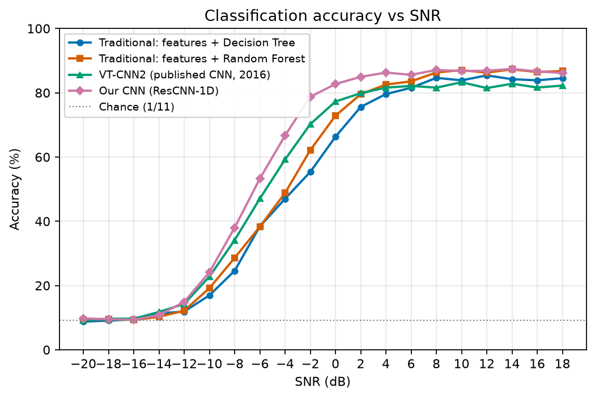
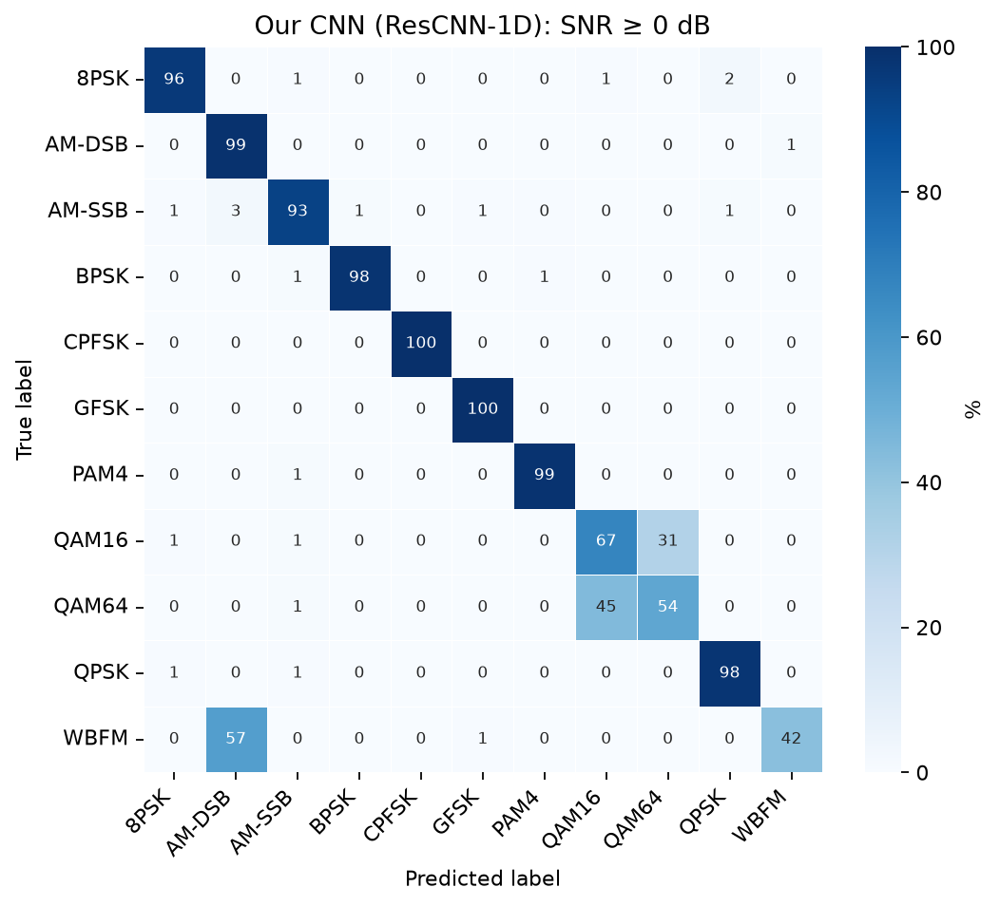

# Results: rml2016a

All methods were tested on exactly the same test clips, which none of them saw during training (44,000 clips, spread evenly across all 11 signal types and all 20 noise levels).

## 1. Main result: accuracy vs noise level

How to read it: left is very noisy, right is clean. Higher is better. The dotted line is pure guessing (1 in 11 = 9.1 %).

## 2. Summary table

| Method | Parameters | Overall | SNR ≥ 0 dB | SNR < 0 dB | At -10 dB | At 0 dB | At +18 dB | Best | ms / decision |
|---|---|---|---|---|---|---|---|---|---|
| Traditional: features + Decision Tree | - | 52.1 % | 81.0 % | 23.3 % | 17.0 % | 66.3 % | 84.5 % | 85.4 % @ 12 dB | 1.57 |
| Traditional: features + Random Forest | - | 54.3 % | 83.9 % | 24.8 % | 19.2 % | 72.9 % | 86.8 % | 87.3 % @ 14 dB | 25.70 |
| VT-CNN2 (published CNN, 2016) | 2,830,427 | 55.1 % | 81.4 % | 28.8 % | 22.8 % | 77.3 % | 82.2 % | 83.3 % @ 10 dB | 1.48 |
| Our CNN (ResCNN-1D) | 125,451 | 58.8 % | 86.1 % | 31.5 % | 24.1 % | 82.7 % | 86.1 % | 87.4 % @ 14 dB | 1.16 |

## 3. Did we meet our targets?

| Target | Met? | Measured |
|---|---|---|
| Our CNN beats the traditional method at every SNR from -10 to +18 dB | **No** | wins at 13 of 15 SNR levels |
| Our CNN is at least as accurate as VT-CNN2 (SNR ≥ 0 dB) with ≥10× fewer parameters | Yes | 86.1 % vs 81.4 %; 22.6× fewer parameters |
| Our CNN reaches ≥ 85 % for SNR ≥ 0 dB | Yes | 86.1 % |
| One decision takes < 5 ms on a laptop CPU | Yes | 1.16 ms |

## 4. Which signals get confused? (Our CNN (ResCNN-1D), SNR ≥ 0 dB)

Each row is the true signal type; each column is what the model said. A perfect model would only have numbers on the diagonal. Biggest mix-ups:

| True type | Mistaken for | How often | Likely reason |
|---|---|---|---|
| WBFM | AM-DSB | 57.0 % | during pauses in the speech both signals reduce to a plain carrier |
| QAM64 | QAM16 | 44.5 % | dense constellations: the inner QAM64 points sit almost on top of QAM16's points |
| QAM16 | QAM64 | 31.3 % | dense constellations: the inner QAM64 points sit almost on top of QAM16's points |
| AM-SSB | AM-DSB | 2.6 % | - |
| 8PSK | QPSK | 2.4 % | QPSK's 4 phase points are a subset of 8PSK's 8 points |
| AM-SSB | BPSK | 1.1 % | - |

## 5. More figures

- Accuracy of each signal type vs SNR (best model): `best_per_class_accuracy.png`
- Confusion at the cleanest, 0 dB and -10 dB levels: `best_confusion_*dB.png`
- Per-model confusion matrices: `<model>/confusion_all_snr.png`, `<model>/confusion_snr_ge_0.png`
- Training curves for the CNNs: `<model>/training_curves.png`
- Feature importance for the Random Forest: `feat_rf/feature_importance.png`
- Example signals of each type: `dataset_examples_*dB.png`

## 6. Speed and size

| Method | Parameters | Model file | One decision (mean) | One decision (95th pct) | Throughput |
|---|---|---|---|---|---|
| Traditional: features + Decision Tree | None | 0.76 MB | 1.57 ms | 2.14 ms | 6,965 clips/s |
| Traditional: features + Random Forest | None | 1305.56 MB | 25.70 ms | 32.05 ms | 4,185 clips/s |
| VT-CNN2 (published CNN, 2016) | 2830427 | 34.02 MB | 1.48 ms | 1.84 ms | 5,482 clips/s |
| Our CNN (ResCNN-1D) | 125451 | 1.69 MB | 1.16 ms | 1.49 ms | 21,157 clips/s |

Measured on: AMD Ryzen 5 5600H with Radeon Graphics, TensorFlow 2.21.0, no GPU. CNN times use XLA compilation (the normal way to deploy a TensorFlow model); traditional-method times include computing the 24 features.
